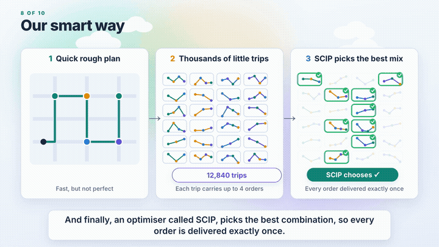

# Delivery Hero VRPPD: CO@Work 2024 challenge

Hybrid heuristic + MIP solution for the Vehicle Routing Problem with Pickup and Delivery
(time windows, rider capacity, max 4 orders per rider, 180 min shift), minimising the sum of
delivery times. MIP solver: SCIP (via PySCIPOpt), as required by the challenge rules.

**Watch the 1.5-minute plain-English explainer (with voice-over):**
[media/rider-routing-explained.mp4](media/rider-routing-explained.mp4)

## The problem in plain English
You order a burger. Somewhere, a rider has to be picked to collect it from the restaurant and
bring it to your door, and the same has to happen for thousands of other hungry people at the
same time. Riders start in different places, each bag holds at most four orders and has a size
limit, a shift lasts at most three hours, and food must be picked up before it is delivered.
The question is who takes which order, and in what sequence, so that the total waiting time of
all customers is as small as possible.

Asking a computer to decide every single turn of every rider is correct but hopeless on big
cities (billions of yes/no choices). So the solver first builds a quick rough plan, then
generates thousands of sensible little trips of up to four orders each, and finally lets SCIP
pick the best combination so every order is delivered exactly once.

## Method
1. Greedy insertion + relocate local search -> feasible warm start
2. Bundle each order with its nearest neighbours (1-4 orders); find each bundle's best visiting
   sequence exactly (branch and bound) for the closest rider types
3. Set-partitioning MIP in SCIP: choose routes so every order is covered exactly once and each
   rider type is used at most as often as it has riders

`exact_mip.py` implements the arc-based model from the challenge description and is used to check
that the hybrid reaches the same optimum on small instances.

## Run
    python3 -m venv venv && venv/bin/pip install -r requirements.txt
    venv/bin/python solve_hybrid.py <instance_folder> out.csv 60
    venv/bin/python run_all.py <training_data> results 40 6
    python3 feasibility_checker.py <training_data>/ results/
    venv/bin/python exact_mip.py <small_instance_folder>

Data: https://github.com/mmghannam/co-work2024 (`Challenge/`). `feasibility_checker.py` is the
organisers' file, included unchanged.

## Results (training set)
148 of 150 instances feasible per the official checker (about 8 s per instance on average, up to
1,223 orders). The other two are infeasible under the rules (13 orders with 2 riders; one order
unreachable within 180 min). The MIP is optimal over the generated route pool, not a proven global
optimum. Per-instance costs: `results/summary.csv`.
